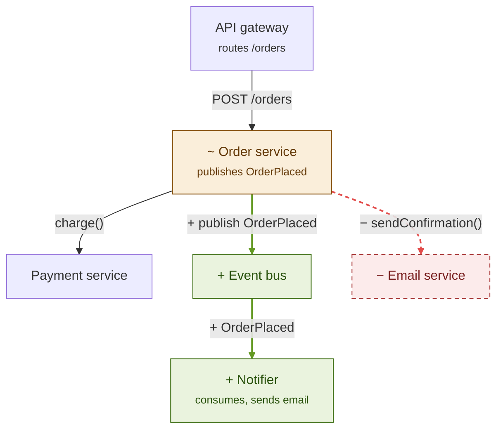
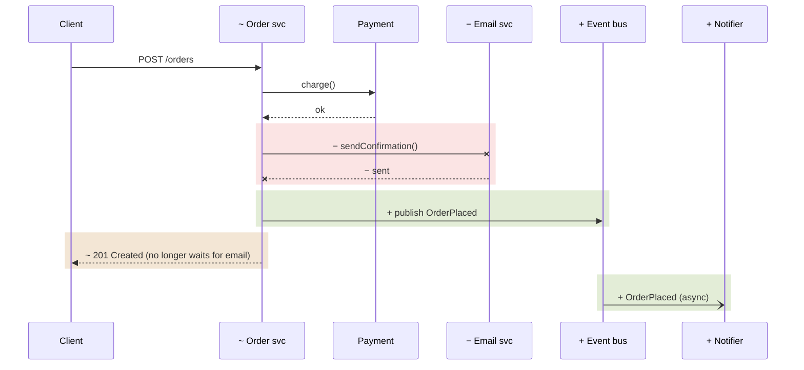

**Goal:** Show a reader what a change moved, in one picture, without making
them compare two. A delta diagram is the after-state with the change marked
on it.

This skill owns *how* to draw one. The skill that calls it owns *where* it
goes, how it is captioned beyond the legend, and how it relates to anything
else in the document.

---

## When to draw one

- Draw one when the change has structure worth seeing: components, modules,
  hooks, services, or stores are added, removed, or rewired; an interaction's
  order or sync/async nature changes; a lifecycle gains or loses states.
- Skip it when the change is structure-free: a typo fix, a copy change, a
  config or constant tweak, a single straight-line function with nothing
  else touching it. A diagram that just restates "file A calls file B" isn't
  worth drawing.
- Depict the mechanism (the data flow, the fan-out a design decision hinges
  on, the state machine), not a restated file list. Label every edge. One
  clean diagram beats three thin ones. **artifact-diagramming** has the
  general judgment on what's worth depicting; apply it even though the
  output here is Mermaid, not an Artifact.
- **Fall back to a before/after pair** at the same zoom level only when the
  change is a wholesale rewrite of the area — roughly half or more of the
  drawn nodes would be red or green — where a delta turns into noise.

## Which form

- **Structural delta (`flowchart`)** — use when the change adds, removes, or
  rewires components, modules, hooks, services, stores, or dependencies:
  something now depends on something it didn't before (or no longer does).
  Answers "what is connected to what now?"
- **Sequence delta (`sequenceDiagram`)** — use when the *order, timing, or
  sync/async nature* of an interaction changes: a call moves after a
  response, a hop is added or removed, work becomes async, a retry or
  fallback path appears. This often matters even when the boxes stay the
  same, which a structural diagram can't show. Answers "what happens, in
  what order, now?"
- **Both** when the structural change exists to change behavior (e.g. a
  queue introduced so a slow call leaves the request path): the flowchart
  shows the new dependency, the sequence shows why it matters.
- A **state-machine delta** (`stateDiagram-v2`) follows the same color
  rules via `classDef` and `class <state> added`, for a change that adds or
  removes states or transitions of an existing lifecycle.
- A brand-new feature with nothing removed still benefits: green new parts
  against unstyled existing context show exactly where it attaches.

## Conventions for every form

- **Four categories, each with a color *and* a text cue**, so the diagram
  still reads in grayscale or for a color-blind reader. Prefix every changed
  node, participant, and edge/message label with its marker:
  - `+` **added** — green
  - `−` **removed** — red, dashed (U+2212 minus, so it doesn't read as a
    bullet or hyphen)
  - `~` **changed** — amber: it exists before and after, but its behavior
    or responsibility changed (say how in its subtitle or label)
  - no prefix, **unchanged** — default styling
- **Draw removed parts in the after-state diagram**, where they used to be,
  so the reader sees what was replaced.
- **Keep unchanged context to one hop** from something that changed. It is
  there to anchor the change, not to map the system.
- **One zoom level per diagram** (C4-style: services *or* modules *or*
  classes, never mixed).
- Use a dashed edge (`-.->`) with a short label starting `gap:` for a
  "should connect but doesn't" gap (unstyled, so it doesn't read as a
  removal); annotate an inferred (not separately stored) state with a
  Mermaid `note`.
- **End each delta diagram's caption with the legend line**, since Mermaid
  has no legend: *Green `+` added · red `−` removed (dashed) · amber `~`
  changed · unstyled unchanged.*

## Structural delta

Copy these `classDef`s verbatim so every diagram uses the same palette.
Declare nodes first, then one edge per line, because `linkStyle` targets
edges by 0-based declaration order (a chained `A --> B --> C` counts as two
edges and makes the indices easy to get wrong):

````markdown

````

Color edges with `linkStyle`: green `#639922` for added, red `#E24B4A` dashed
for removed, amber `#BA7517` for changed. Recount the indices after any
edit to the edge list.

## Sequence delta

Mermaid can't color individual messages, so shade the changed span with a
`rect` block instead (translucent `rgba`, which reads in both light and dark
themes), keep the prefixes in participant aliases and message text, and end
removed messages with a cross (`-x` / `--x`):

````markdown

````

Shade only the messages that changed. Leave unchanged messages outside any
`rect` so the shading stays meaningful. Use `-)` for async messages.

## Where they render

Both Obsidian and GitHub (PR descriptions, comments, Markdown files) render
`mermaid` fences natively, so no image asset is needed. Two placement traps:

- **Never put a diagram inside an HTML comment** (`<!-- … -->`). Mermaid
  edges and replies contain `--` and `-->`, which end the comment early and
  spill the rest of it into the rendered page. Where the surrounding
  document keeps AI-written material hidden (e.g. PR talking points), put
  the diagram in a collapsed `<details>` block instead, as the calling
  skill describes.
- Leave a blank line before and after the fence when it sits inside
  `<details>` or other HTML, or GitHub renders the fence as plain text.

---

## Related skills

- **pr-review-to-obsidian** — architecture overview in a code-review note
- **claude-tasks** — PR descriptions for delegated tasks
- **git-and-pr-conventions** — talking points beside a work PR's template
- **artifact-diagramming** — general judgment on what's worth drawing
